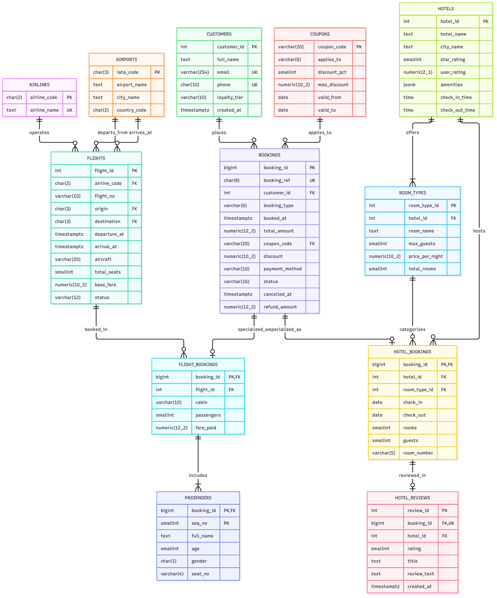
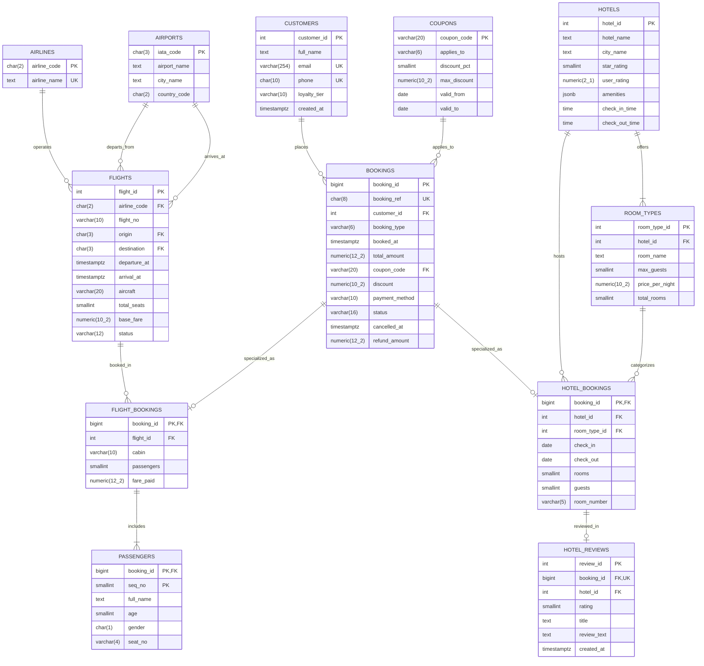

# Phase 2: Schema Design and Data Loading

This document details the relational schema design, data dictionary, integrity constraints, indexing baseline, normalization analysis, and data verification results for the MakeMyTrip (`mmt`) database.

---

## 1. Overview

The `mmt` database represents a multi-vertical online travel agency (OTA) supporting flight and hotel reservations, user management, discount promotions, and post-stay hotel reviews. The relational design rebuilds production functionality across **12 tables** loaded from sanitized CSV exports.

- **Schema Name:** `mmt`
- **Target Engine:** PostgreSQL 15 or newer (verified on PostgreSQL 18.6)
- **Session Timezone:** `Asia/Kolkata` (all timestamps carry `+05:30` offsets)
- **Build & Load Sequence:**
  1. `sql/01_schema.sql`: Creates schema `mmt`, defines domain types, tables, primary keys, foreign keys, unique keys, and check constraints.
  2. `sql/02_load_data.sql`: Populates tables in strict dependency order using `\copy`, executes `ANALYZE`, and verifies row counts and data integrity assertions.

### Table Loading Dependency Order

Because foreign keys are strictly enforced upon insertion, data must load in parent-to-child topological order:

1. `airports` (standalone reference catalog)
2. `airlines` (standalone reference catalog)
3. `flights` (depends on `airlines`, `airports` [origin, destination])
4. `hotels` (standalone accommodation catalog)
5. `room_types` (depends on `hotels`)
6. `customers` (standalone user entity)
7. `coupons` (standalone promotion entity)
8. `bookings` (depends on `customers`, `coupons`)
9. `flight_bookings` (specialization table; depends on `bookings`, `flights`)
10. `passengers` (child detail; depends on `flight_bookings`)
11. `hotel_bookings` (specialization table; depends on `bookings`, `hotels`, `room_types`)
12. `hotel_reviews` (child feedback; depends on `hotel_bookings`)

---

## 2. Data Dictionary

The data dictionary below matches `sql/01_schema.sql` exactly. Every column type and constraint is selected according to domain boundaries and workload requirements.

### 2.1 `airports`
Reference table of commercial airports identified by standard IATA codes.

| Column | Type | Constraints | Why |
|---|---|---|---|
| `iata_code` | `CHAR(3)` | `NOT NULL`, `PRIMARY KEY`, `CHECK (iata_code ~ '^[A-Z]{3}$')` | Fixed 3-letter uppercase IATA standard identifier (e.g., DEL, BOM). |
| `airport_name` | `TEXT` | `NOT NULL` | Full airport display name; variable length text avoids arbitrary truncation. |
| `city_name` | `TEXT` | `NOT NULL` | Serving city name for search filters (R01, R02). |
| `country_code` | `CHAR(2)` | `NOT NULL` | Standard ISO 3166-1 alpha-2 country code (e.g., IN). |

### 2.2 `airlines`
Reference table of operating commercial airlines.

| Column | Type | Constraints | Why |
|---|---|---|---|
| `airline_code` | `CHAR(2)` | `NOT NULL`, `PRIMARY KEY` | Fixed 2-character IATA airline code (e.g., 6E, AI). |
| `airline_name` | `TEXT` | `NOT NULL`, `UNIQUE` | Distinct commercial brand name of the carrier. |

### 2.3 `flights`
Individual scheduled flight instances between origin and destination airports.

| Column | Type | Constraints | Why |
|---|---|---|---|
| `flight_id` | `INTEGER` | `NOT NULL`, `PRIMARY KEY` | Unique surrogate identifier for each dated flight schedule. |
| `airline_code` | `CHAR(2)` | `NOT NULL`, `FK -> airlines(airline_code) ON DELETE RESTRICT` | Carrier operating the flight; restricted to prevent orphaned flights. |
| `flight_no` | `VARCHAR(10)` | `NOT NULL`, `CHECK (flight_no LIKE airline_code \|\| '-%')` | Airline-assigned flight designator, validated to begin with carrier code. |
| `origin` | `CHAR(3)` | `NOT NULL`, `FK -> airports(iata_code) ON DELETE RESTRICT` | Departure airport reference. |
| `destination` | `CHAR(3)` | `NOT NULL`, `FK -> airports(iata_code) ON DELETE RESTRICT` | Arrival airport reference. |
| `departure_at` | `TIMESTAMPTZ` | `NOT NULL` | Exact scheduled departure with Indian Standard Time (`+05:30`) zone offset. |
| `arrival_at` | `TIMESTAMPTZ` | `NOT NULL`, `CHECK (arrival_at > departure_at)` | Scheduled arrival time; constrained to occur chronologically after departure. |
| `aircraft` | `VARCHAR(20)` | `NOT NULL` | Aircraft model descriptor (e.g., A320neo, B737-8). |
| `total_seats` | `SMALLINT` | `NOT NULL`, `CHECK (total_seats > 0)` | Total cabin seating capacity; smallint (-32k to 32k) fits aircraft sizes. |
| `base_fare` | `NUMERIC(10,2)` | `NOT NULL`, `CHECK (base_fare > 0)` | Base ticket price requiring exact currency decimal representation. |
| `status` | `VARCHAR(12)` | `NOT NULL`, `CHECK (status IN ('SCHEDULED','DELAYED','DEPARTED','LANDED','CANCELLED'))` | Discrete lifecycle state of the flight operation. |

*Additional Table Constraints:*
- `UNIQUE (flight_no, departure_at)`: Prevents duplicate flight departures for the same flight number at the same timestamp.
- `CHECK (origin <> destination)`: A flight cannot depart and arrive at the same airport.

### 2.4 `hotels`
Accommodation catalog containing property ratings and amenities.

| Column | Type | Constraints | Why |
|---|---|---|---|
| `hotel_id` | `INTEGER` | `NOT NULL`, `PRIMARY KEY` | Unique identifier for each hotel property. |
| `hotel_name` | `TEXT` | `NOT NULL` | Commercial hotel property name. |
| `city_name` | `TEXT` | `NOT NULL` | City location used in geographic queries (R03, R15, R18, R24). |
| `star_rating` | `SMALLINT` | `NOT NULL`, `CHECK (star_rating BETWEEN 1 AND 5)` | Official hospitality rating on a 1–5 scale. |
| `user_rating` | `NUMERIC(2,1)` | `CHECK (user_rating BETWEEN 0 AND 5)` | Aggregate guest review score (0.0 to 5.0); nullable when unrated. |
| `amenities` | `JSONB` | `NOT NULL`, `CHECK (jsonb_typeof(amenities) = 'object')` | Structured JSON object storing boolean service flags (`gym`, `spa`, `pool`, etc.). |
| `check_in_time` | `TIME` | `NOT NULL` | Standard daily check-in time boundary (e.g., 14:00:00). |
| `check_out_time` | `TIME` | `NOT NULL` | Standard daily checkout time boundary (e.g., 11:00:00). |

### 2.5 `room_types`
Inventory categories offered by each hotel property.

| Column | Type | Constraints | Why |
|---|---|---|---|
| `room_type_id` | `INTEGER` | `NOT NULL`, `PRIMARY KEY` | Unique room inventory category identifier across hotels. |
| `hotel_id` | `INTEGER` | `NOT NULL`, `FK -> hotels(hotel_id) ON DELETE RESTRICT` | Parent hotel property offering this room tier. |
| `room_name` | `TEXT` | `NOT NULL` | Tier name (e.g., Standard Room, Deluxe Suite). |
| `max_guests` | `SMALLINT` | `NOT NULL`, `CHECK (max_guests > 0)` | Maximum guest capacity per room. |
| `price_per_night` | `NUMERIC(10,2)` | `NOT NULL`, `CHECK (price_per_night > 0)` | Exact nightly rate in INR without floating-point rounding errors. |
| `total_rooms` | `SMALLINT` | `NOT NULL`, `CHECK (total_rooms > 0)` | Total physical room count available in this category. |

*Additional Table Constraints:*
- `UNIQUE (room_type_id, hotel_id)`: Composite natural key enabling multi-column foreign key validation from `hotel_bookings`.

### 2.6 `customers`
Registered traveller accounts and loyalty information.

| Column | Type | Constraints | Why |
|---|---|---|---|
| `customer_id` | `INTEGER` | `NOT NULL`, `PRIMARY KEY` | Unique customer identity number. |
| `full_name` | `TEXT` | `NOT NULL` | Customer's legal name. |
| `email` | `VARCHAR(254)` | `NOT NULL`, `UNIQUE` | Unique email address conforming to RFC 5321 length limits. |
| `phone` | `CHAR(10)` | `NOT NULL`, `UNIQUE`, `CHECK (phone ~ '^[0-9]{10}$')` | 10-digit Indian mobile contact number. |
| `loyalty_tier` | `VARCHAR(10)` | `NOT NULL`, `CHECK (loyalty_tier IN ('BLUE','SILVER','GOLD','PLATINUM'))` | Membership tier determining promotion rules and concessions. |
| `created_at` | `TIMESTAMPTZ` | `NOT NULL` | Account registration timestamp with time zone. |

### 2.7 `coupons`
Promotional discount rules and validity periods.

| Column | Type | Constraints | Why |
|---|---|---|---|
| `coupon_code` | `VARCHAR(20)` | `NOT NULL`, `PRIMARY KEY` | Promo code identifier entered by customers at checkout. |
| `applies_to` | `VARCHAR(6)` | `NOT NULL`, `CHECK (applies_to IN ('FLIGHT','HOTEL','ALL'))` | Eligible booking product category. |
| `discount_pct` | `SMALLINT` | `NOT NULL`, `CHECK (discount_pct BETWEEN 1 AND 100)` | Percentage reduction applied to booking total. |
| `max_discount` | `NUMERIC(10,2)` | `NOT NULL` | Monetary cap on the applied discount amount. |
| `valid_from` | `DATE` | `NOT NULL` | Effective start date of the coupon. |
| `valid_to` | `DATE` | `NOT NULL`, `CHECK (valid_to >= valid_from)` | Expiry date of promotion; constrained to follow `valid_from`. |

### 2.8 `bookings`
Core master transaction records capturing payment and lifecycle state.

| Column | Type | Constraints | Why |
|---|---|---|---|
| `booking_id` | `BIGINT` | `NOT NULL`, `PRIMARY KEY` | Unique order identifier. Plain `BIGINT` (not `IDENTITY`) because write workload W01 supplies explicit ID values. |
| `booking_ref` | `CHAR(8)` | `NOT NULL`, `UNIQUE`, `CHECK (booking_ref ~ '^MM[0-9A-Z]{6}$')` | 8-character public confirmation reference prefixed with `MM`. |
| `customer_id` | `INTEGER` | `NOT NULL`, `FK -> customers(customer_id) ON DELETE RESTRICT` | Account placing the reservation; restricted from deletion. |
| `booking_type` | `VARCHAR(6)` | `NOT NULL`, `CHECK (booking_type IN ('FLIGHT','HOTEL'))` | Specialization discriminator. |
| `booked_at` | `TIMESTAMPTZ` | `NOT NULL` | Transaction creation timestamp with timezone. |
| `total_amount` | `NUMERIC(12,2)` | `NOT NULL`, `CHECK (total_amount > 0)` | Net payable transaction balance after discounts. |
| `coupon_code` | `VARCHAR(20)` | `FK -> coupons(coupon_code) ON DELETE RESTRICT` | Optional promotion applied. Nullable when no coupon used. |
| `discount` | `NUMERIC(10,2)` | `NOT NULL`, `DEFAULT 0`, `CHECK (discount >= 0)` | Value deducted from gross fare; defaults to 0 as W01 omits discount. |
| `payment_method` | `VARCHAR(10)` | `NOT NULL`, `CHECK (payment_method IN ('UPI','CARD','WALLET','NETBANKING','EMI'))` | Payment instrument used. |
| `status` | `VARCHAR(16)` | `NOT NULL`, `CHECK (status IN ('PENDING_PAYMENT','CONFIRMED','COMPLETED','CANCELLED'))` | Order lifecycle status. |
| `cancelled_at` | `TIMESTAMPTZ` | Nullable, `CHECK (cancelled_at IS NULL OR cancelled_at >= booked_at)` | Cancellation event timestamp; present only on cancelled bookings. |
| `refund_amount` | `NUMERIC(12,2)` | Nullable, `CHECK (refund_amount IS NULL OR (refund_amount > 0 AND refund_amount <= total_amount))` | Reimbursed amount; cannot exceed original total amount. |

*Additional Table Constraints:*
- `CHECK ((status = 'CANCELLED') = (cancelled_at IS NOT NULL))`: Enforces bidirectional requirement for cancellation time.
- `CHECK ((status = 'CANCELLED') = (refund_amount IS NOT NULL))`: Enforces bidirectional requirement for refund figure.
- `CHECK ((coupon_code IS NULL) = (discount = 0))`: Enforces that non-zero discounts require a valid coupon code and vice versa.

### 2.9 `flight_bookings`
Flight vertical specialization table storing booking-level fare and flight associations.

| Column | Type | Constraints | Why |
|---|---|---|---|
| `booking_id` | `BIGINT` | `NOT NULL`, `PRIMARY KEY`, `FK -> bookings(booking_id) ON DELETE CASCADE` | 1:0..1 subtype PK and FK to parent booking; deleted when parent booking is deleted. |
| `flight_id` | `INTEGER` | `NOT NULL`, `FK -> flights(flight_id) ON DELETE RESTRICT` | Scheduled flight instance booked. |
| `cabin` | `VARCHAR(10)` | `NOT NULL`, `CHECK (cabin IN ('ECONOMY','PREMIUM','BUSINESS'))` | Cabin travel class booked. |
| `passengers` | `SMALLINT` | `NOT NULL`, `CHECK (passengers > 0)` | Number of passenger seats reserved on this booking. |
| `fare_paid` | `NUMERIC(12,2)` | `NOT NULL`, `CHECK (fare_paid > 0)` | Gross flight fare before coupon discount. |

### 2.10 `passengers`
Individual traveller manifest records under a flight reservation.

| Column | Type | Constraints | Why |
|---|---|---|---|
| `booking_id` | `BIGINT` | `NOT NULL`, `PK (Part 1)`, `FK -> flight_bookings(booking_id) ON DELETE CASCADE` | References parent flight reservation; cascades on deletion. |
| `seq_no` | `SMALLINT` | `NOT NULL`, `PK (Part 2)`, `CHECK (seq_no >= 1)` | 1-based sequential passenger index within the booking. |
| `full_name` | `TEXT` | `NOT NULL` | Passenger manifest name. |
| `age` | `SMALLINT` | `NOT NULL`, `CHECK (age BETWEEN 0 AND 120)` | Age in years, enabling concession checks (R21). |
| `gender` | `CHAR(1)` | `NOT NULL`, `CHECK (gender IN ('M','F','X'))` | Gender classification standard. |
| `seat_no` | `VARCHAR(4)` | Nullable, `CHECK (seat_no IS NULL OR seat_no ~ '^[0-9]{1,2}[A-K]$')` | Boarding seat assignment (e.g., `16D`); null prior to web check-in. |

### 2.11 `hotel_bookings`
Hotel stay vertical specialization table tracking property, dates, and room allocations.

| Column | Type | Constraints | Why |
|---|---|---|---|
| `booking_id` | `BIGINT` | `NOT NULL`, `PRIMARY KEY`, `FK -> bookings(booking_id) ON DELETE CASCADE` | 1:0..1 subtype PK and FK to parent booking; cascades on booking delete. |
| `hotel_id` | `INTEGER` | `NOT NULL`, `FK -> hotels(hotel_id) ON DELETE RESTRICT` | Hotel property reserved. |
| `room_type_id` | `INTEGER` | `NOT NULL` | Specific room tier selected. |
| `check_in` | `DATE` | `NOT NULL` | Arrival date of hotel stay. |
| `check_out` | `DATE` | `NOT NULL`, `CHECK (check_out > check_in)` | Departure date; constrained to follow check-in. |
| `rooms` | `SMALLINT` | `NOT NULL`, `CHECK (rooms >= 1)` | Number of physical rooms reserved. |
| `guests` | `SMALLINT` | `NOT NULL`, `CHECK (guests >= 1)` | Total guest count. |
| `room_number` | `VARCHAR(5)` | Nullable, `CHECK (room_number IS NULL OR room_number ~ '^[0-9]{3,4}$')` | Room number assigned at check-in (W05); stored as text because W05 assigns text values and room numbers can have leading zeros or alphanumeric codes. |

*Additional Table Constraints:*
- `UNIQUE (booking_id, hotel_id)`: Composite candidate key supporting foreign key referencing from `hotel_reviews`.
- `FOREIGN KEY (room_type_id, hotel_id) REFERENCES room_types (room_type_id, hotel_id) ON DELETE RESTRICT`: Enforces that the booked room type actually belongs to the specified hotel.

### 2.12 `hotel_reviews`
Verified guest reviews submitted after completed hotel stays.

| Column | Type | Constraints | Why |
|---|---|---|---|
| `review_id` | `INTEGER` | `NOT NULL`, `PRIMARY KEY` | Unique review identifier. |
| `booking_id` | `BIGINT` | `NOT NULL`, `UNIQUE` | One review per hotel reservation. |
| `hotel_id` | `INTEGER` | `NOT NULL` | Redundant foreign key column pointing to the hotel being reviewed. |
| `rating` | `SMALLINT` | `NOT NULL`, `CHECK (rating BETWEEN 1 AND 5)` | Guest stay rating score. |
| `title` | `TEXT` | `NOT NULL` | Review summary title. |
| `review_text` | `TEXT` | Nullable | Detailed user review prose; null if guest left only a score/title. |
| `created_at` | `TIMESTAMPTZ` | `NOT NULL` | Timestamp review was posted. |

*Additional Table Constraints:*
- `FOREIGN KEY (booking_id, hotel_id) REFERENCES hotel_bookings (booking_id, hotel_id) ON DELETE CASCADE`: Enforces that the review hotel matches the reservation hotel, cascading deletion if the stay record is deleted.

---

## 3. Keys and Relationships

### 3.1 Primary Keys and Composite Keys
- Single-column primary keys are defined on `airports(iata_code)`, `airlines(airline_code)`, `flights(flight_id)`, `hotels(hotel_id)`, `room_types(room_type_id)`, `customers(customer_id)`, `coupons(coupon_code)`, `bookings(booking_id)`, and `hotel_reviews(review_id)`.
- **Specialization Primary Keys:** `flight_bookings(booking_id)` and `hotel_bookings(booking_id)` use `booking_id` simultaneously as their `PRIMARY KEY` and `FOREIGN KEY` referencing `bookings(booking_id)`. This guarantees an exact `1 : 0..1` subtype relationship where a general booking can specialize into at most one vertical entity.
- **Composite Primary Key:** `passengers(booking_id, seq_no)` uniquely identifies a traveller within a given flight booking using a composite key, avoiding unnecessary surrogate sequences.

### 3.2 Foreign Keys and ON DELETE Action Rules
1. `bookings.customer_id -> customers(customer_id) ON DELETE RESTRICT`: Prevents deletion of customer records that have active or historical booking records.
2. `bookings.coupon_code -> coupons(coupon_code) ON DELETE RESTRICT`: Reference integrity for promotional vouchers. `ON DELETE SET NULL` is deliberately **not** used because setting `coupon_code` to `NULL` on an existing booking would violate the `chk_bookings_coupon_discount` constraint (`(coupon_code IS NULL) = (discount = 0)`), leaving a non-zero discount with a null coupon.
3. `flight_bookings.booking_id -> bookings(booking_id) ON DELETE CASCADE`: Removing a flight booking automatically purges its vertical metadata.
4. `flight_bookings.flight_id -> flights(flight_id) ON DELETE RESTRICT`: Scheduled flights cannot be deleted if reservations are booked on them.
5. `passengers.booking_id -> flight_bookings(booking_id) ON DELETE CASCADE`: Passenger manifests are owned by the booking; deleting the flight booking cascades to remove all associated passengers.
6. `hotel_bookings.booking_id -> bookings(booking_id) ON DELETE CASCADE`: Deleting a hotel booking removes its stay details.
7. `hotel_bookings.hotel_id -> hotels(hotel_id) ON DELETE RESTRICT`: Hotels with existing bookings cannot be deleted.
8. `hotel_reviews.(booking_id, hotel_id) -> hotel_bookings(booking_id, hotel_id) ON DELETE CASCADE`: Reviews belong to hotel reservations and are automatically purged if the reservation is deleted.

### 3.3 Composite Foreign Keys Enforcing Multi-Table Consistency
To prevent relational anomalies where a child record references attributes belonging to different entities:
- `hotel_bookings(room_type_id, hotel_id) -> room_types(room_type_id, hotel_id)`: A guest cannot reserve a room type belonging to Hotel A under a booking assigned to Hotel B.
- `hotel_reviews(booking_id, hotel_id) -> hotel_bookings(booking_id, hotel_id)`: A review submitted for booking ID X cannot be mistakenly linked to Hotel Y if booking X was made at Hotel Z.

### 3.4 Entity Cardinality Table

| Parent Entity | Relationship | Child Entity | Description |
|---|:---:|---|---|
| `customers` | 1 : N | `bookings` | A customer can place zero or many bookings; every booking belongs to one customer. |
| `bookings` | 1 : 0..1 | `flight_bookings` | A booking is either a flight booking or not; at most one flight specialization row exists. |
| `bookings` | 1 : 0..1 | `hotel_bookings` | A booking is either a hotel booking or not; at most one hotel specialization row exists. |
| `flight_bookings` | 1 : N | `passengers` | Each flight booking has 1 to 9 passengers (manifest rows). |
| `flights` | 1 : N | `flight_bookings` | A flight schedule accommodates multiple reservations across its cabin. |
| `airlines` | 1 : N | `flights` | An airline operates multiple flight departures. |
| `airports` | 1 : N | `flights` (origin) | An airport serves as origin for multiple departing flights. |
| `airports` | 1 : N | `flights` (destination) | An airport serves as destination for multiple arriving flights. |
| `hotels` | 1 : N | `room_types` | A hotel offers one or more room categories. |
| `room_types` | 1 : N | `hotel_bookings` | A room tier accommodates multiple reservations over time. |
| `hotel_bookings` | 1 : 0..1 | `hotel_reviews` | A completed hotel stay receives at most one guest review. |
| `coupons` | 1 : N | `bookings` | A promo coupon can be redeemed across zero or many bookings. |

---

## 4. Entity-Relationship (ER) Diagram





---

## 5. Indexes After Phase 2

In compliance with Phase 2 rules, **no secondary performance tuning indexes have been created**. The only indexes present on the system are the 20 B-tree indexes automatically generated by PostgreSQL to enforce `PRIMARY KEY` and `UNIQUE` constraints.

### Catalog Query Output (`pg_indexes`)

```sql
SELECT tablename, indexname, indexdef 
FROM pg_indexes 
WHERE schemaname='mmt' 
ORDER BY 1,2;
```

| Table Name | Index Name | Index Definition |
|---|---|---|
| `airlines` | `pk_airlines` | `CREATE UNIQUE INDEX pk_airlines ON mmt.airlines USING btree (airline_code)` |
| `airlines` | `uq_airlines_airline_name` | `CREATE UNIQUE INDEX uq_airlines_airline_name ON mmt.airlines USING btree (airline_name)` |
| `airports` | `pk_airports` | `CREATE UNIQUE INDEX pk_airports ON mmt.airports USING btree (iata_code)` |
| `bookings` | `pk_bookings` | `CREATE UNIQUE INDEX pk_bookings ON mmt.bookings USING btree (booking_id)` |
| `bookings` | `uq_bookings_booking_ref` | `CREATE UNIQUE INDEX uq_bookings_booking_ref ON mmt.bookings USING btree (booking_ref)` |
| `coupons` | `pk_coupons` | `CREATE UNIQUE INDEX pk_coupons ON mmt.coupons USING btree (coupon_code)` |
| `customers` | `pk_customers` | `CREATE UNIQUE INDEX pk_customers ON mmt.customers USING btree (customer_id)` |
| `customers` | `uq_customers_email` | `CREATE UNIQUE INDEX uq_customers_email ON mmt.customers USING btree (email)` |
| `customers` | `uq_customers_phone` | `CREATE UNIQUE INDEX uq_customers_phone ON mmt.customers USING btree (phone)` |
| `flight_bookings` | `pk_flight_bookings` | `CREATE UNIQUE INDEX pk_flight_bookings ON mmt.flight_bookings USING btree (booking_id)` |
| `flights` | `pk_flights` | `CREATE UNIQUE INDEX pk_flights ON mmt.flights USING btree (flight_id)` |
| `flights` | `uq_flights_number_departure` | `CREATE UNIQUE INDEX uq_flights_number_departure ON mmt.flights USING btree (flight_no, departure_at)` |
| `hotel_bookings` | `pk_hotel_bookings` | `CREATE UNIQUE INDEX pk_hotel_bookings ON mmt.hotel_bookings USING btree (booking_id)` |
| `hotel_bookings` | `uq_hotel_bookings_booking_hotel` | `CREATE UNIQUE INDEX uq_hotel_bookings_booking_hotel ON mmt.hotel_bookings USING btree (booking_id, hotel_id)` |
| `hotel_reviews` | `pk_hotel_reviews` | `CREATE UNIQUE INDEX pk_hotel_reviews ON mmt.hotel_reviews USING btree (review_id)` |
| `hotel_reviews` | `uq_hotel_reviews_booking` | `CREATE UNIQUE INDEX uq_hotel_reviews_booking ON mmt.hotel_reviews USING btree (booking_id)` |
| `hotels` | `pk_hotels` | `CREATE UNIQUE INDEX pk_hotels ON mmt.hotels USING btree (hotel_id)` |
| `passengers` | `pk_passengers` | `CREATE UNIQUE INDEX pk_passengers ON mmt.passengers USING btree (booking_id, seq_no)` |
| `room_types` | `pk_room_types` | `CREATE UNIQUE INDEX pk_room_types ON mmt.room_types USING btree (room_type_id)` |
| `room_types` | `uq_room_types_id_hotel` | `CREATE UNIQUE INDEX uq_room_types_id_hotel ON mmt.room_types USING btree (room_type_id, hotel_id)` |

- **Total Indexes:** 20 (all primary or unique key index enforcements)
- **Total CHECK Constraints:** **37** registered and active in `pg_constraint`.

---

## 6. Null Behaviour Analysis

Every column allowed to be NULL represents an intentional, domain-specific state rather than missing data.

### 6.1 Empirical NULL Counts

| Table | Column | NULL Count | Total Table Rows | Percentage NULL | Business Reason |
|---|---|---:|---:|---:|---|
| `bookings` | `coupon_code` | 127,144 | 144,792 | 87.81% | Customer did not apply a promotional coupon code. |
| `bookings` | `cancelled_at` | 133,298 | 144,792 | 92.06% | Booking is active (completed, confirmed, or pending); only cancelled bookings have cancellation dates. |
| `bookings` | `refund_amount` | 133,298 | 144,792 | 92.06% | Refunds are only processed on cancelled bookings. |
| `passengers` | `seat_no` | 21,612 | 163,380 | 13.23% | Seat numbers are assigned at web check-in. Passengers who have not checked in have no seat. |
| `hotel_bookings` | `room_number` | 6,815 | 59,893 | 11.38% | Room numbers are assigned upon physical arrival at the front desk (W05); absent prior to check-in. |
| `hotels` | `user_rating` | 134 | 3,000 | 4.47% | Newly listed or unrated hotel properties with insufficient guest reviews. |
| `hotel_reviews` | `review_text` | 4,812 | 15,913 | 30.24% | Reviewer provided a numerical star rating and title, but left the written feedback body blank. |
| `hotel_reviews` | `title` | 0 | 15,913 | 0.00% | Mandatory review field; title is never NULL. |

### 6.2 Null Pattern Verification

#### 1. Booking Status vs Cancellation Fields
```sql
SELECT status, (cancelled_at IS NULL) AS cancelled_null, (refund_amount IS NULL) AS refund_null, count(*)
FROM bookings GROUP BY 1, 2, 3 ORDER BY 1;
```
- `CANCELLED`: `cancelled_at` NOT NULL, `refund_amount` NOT NULL -> **11,494 rows**
- `COMPLETED`: `cancelled_at` NULL, `refund_amount` NULL -> **128,395 rows**
- `CONFIRMED`: `cancelled_at` NULL, `refund_amount` NULL -> **4,806 rows**
- `PENDING_PAYMENT`: `cancelled_at` NULL, `refund_amount` NULL -> **97 rows**

*Observation:* Confirms 100% adherence to `chk_bookings_cancelled_at_matches_status` and `chk_bookings_refund_matches_status`.

#### 2. Coupon Code vs Discount
```sql
SELECT (coupon_code IS NULL) AS coupon_null, (discount = 0) AS discount_zero, count(*)
FROM bookings GROUP BY 1, 2;
```
- `coupon_code` NOT NULL and `discount > 0`: **17,648 rows**
- `coupon_code` NULL and `discount = 0`: **127,144 rows**
- Mismatches: **0 rows**

*Observation:* `coupon_code IS NULL` is strictly equivalent to `discount = 0`.

#### 3. Passenger Seat Assignment by Booking Status
```sql
SELECT b.status, count(*) AS total_pax, count(p.seat_no) AS seats_assigned, count(*) - count(p.seat_no) AS seats_null
FROM passengers p
JOIN flight_bookings fb ON fb.booking_id = p.booking_id
JOIN bookings b ON b.booking_id = fb.booking_id
GROUP BY b.status ORDER BY b.status;
```
- `CANCELLED`: 12,904 passengers (11,188 assigned before cancellation; 1,716 null)
- `COMPLETED`: 145,029 passengers (130,579 assigned; 14,450 null where passengers never completed web check-in)
- `CONFIRMED`: 5,322 passengers (0 assigned; 5,322 null because upcoming flights have not opened or completed web check-in)
- `PENDING_PAYMENT`: 125 passengers (1 assigned seat due to Data Problem DP3; 124 null)

#### 4. Hotel Room Number Assignment by Booking Status
```sql
SELECT b.status, count(*) AS total_hotel, count(hb.room_number) AS room_assigned, count(*) - count(hb.room_number) AS room_null
FROM hotel_bookings hb
JOIN bookings b ON b.booking_id = hb.booking_id
GROUP BY b.status ORDER BY b.status;
```
- `CANCELLED`: 4,810 bookings (0 assigned; 4,810 null)
- `COMPLETED`: 53,078 bookings (53,078 assigned; 0 null — 100% check-in completion)
- `CONFIRMED`: 1,971 bookings (0 assigned; 1,971 null — awaiting arrival date W05)
- `PENDING_PAYMENT`: 34 bookings (0 assigned; 34 null)

### 6.3 Customer Email Case Sensitivity and R23
The `customers.email` column has a standard B-tree `UNIQUE` constraint, which in PostgreSQL is case-sensitive (`test@rediffmail.com` and `Test@rediffmail.com` are treated as distinct). Query R23 performs case-insensitive lookup using `WHERE lower(email) = lower($1)`.
- Query analysis confirms that the seed data contains **0 case-insensitive duplicates** (`count(*) - count(DISTINCT lower(email)) = 0`).
- Because the baseline index is on `email` directly, R23 is forced to execute an expensive Sequential Scan over all 40,000 customers.
- **Phase 4 Opportunity:** Introduce an expression index `CREATE UNIQUE INDEX idx_customers_lower_email ON customers (lower(email));` to guarantee both case-insensitive uniqueness and index-accelerated lookups for R23.

---

## 7. Functional Dependencies and Normal Forms

### 7.1 Table-by-Table Normal Form Breakdown

| Table | Candidate Keys | Non-Trivial Functional Dependencies | Normal Form |
|---|---|---|---|
| `airports` | `iata_code` | `iata_code -> airport_name, city_name, country_code` | **BCNF** |
| `airlines` | `airline_code`, `airline_name` | `airline_code <-> airline_name` | **BCNF** |
| `flights` | `flight_id`, `(flight_no, departure_at)` | `flight_id <-> (flight_no, departure_at)`, `flight_no -> airline_code`, `aircraft -> total_seats`, `flight_id -> origin, destination, arrival_at, base_fare, status` | **2NF** (3NF violation) |
| `hotels` | `hotel_id` | `hotel_id -> hotel_name, city_name, star_rating, user_rating, amenities, check_in_time, check_out_time` | **BCNF** |
| `room_types` | `room_type_id`, `(room_type_id, hotel_id)` | `room_type_id -> hotel_id, room_name, max_guests, price_per_night, total_rooms` | **BCNF** |
| `customers` | `customer_id`, `email`, `phone` | `customer_id <-> email <-> phone`, `customer_id -> full_name, loyalty_tier, created_at` | **BCNF** |
| `coupons` | `coupon_code` | `coupon_code -> applies_to, discount_pct, max_discount, valid_from, valid_to` | **BCNF** |
| `bookings` | `booking_id`, `booking_ref` | `booking_id <-> booking_ref`, `booking_id -> customer_id, booking_type, booked_at, total_amount, coupon_code, discount, payment_method, status, cancelled_at, refund_amount` | **BCNF** |
| `flight_bookings` | `booking_id` | `booking_id -> flight_id, cabin, passengers, fare_paid` | **BCNF** |
| `passengers` | `(booking_id, seq_no)` | `(booking_id, seq_no) -> full_name, age, gender, seat_no` | **BCNF** |
| `hotel_bookings` | `booking_id`, `(booking_id, hotel_id)` | `booking_id -> hotel_id, room_type_id, check_in, check_out, rooms, guests, room_number`, `room_type_id -> hotel_id` | **2NF** (3NF violation) |
| `hotel_reviews` | `review_id`, `booking_id` | `review_id <-> booking_id`, `booking_id -> hotel_id, rating, title, review_text, created_at` | **BCNF** |

### 7.2 Explicit Normal Form Discussion

#### 1. Transitive Dependencies in `flights` (2NF)
In `flights`, the primary key is `flight_id`. However:
- `aircraft -> total_seats`: In the dataset, every aircraft type strictly determines seating capacity (A320neo always has 186 seats; A321neo always has 232 seats; B737-8 always has 189 seats; verified via `SELECT aircraft, count(DISTINCT total_seats)` which returns 1 distinct count for all 3 aircraft models).
- `flight_no -> airline_code`: Every flight number uniquely maps to a single airline prefix (`6E-137` is always `6E`).
These transitive dependencies violate 3NF.
- *Why kept:* The schema preserves the exact CSV layout required by the project specifications and benchmark queries (R01, R08, R19), which reference `flights.total_seats` and `flights.aircraft` directly.
- *Decomposition to achieve BCNF:* Decompose `flights` into:
  1. `aircraft_models (aircraft PK, total_seats)`
  2. `flight_routes (flight_no PK, airline_code FK, origin FK, destination FK)`
  3. `flights (flight_id PK, flight_no FK, aircraft FK, departure_at, arrival_at, base_fare, status)`

#### 2. Transitive Dependency in `hotel_bookings` (2NF)
In `hotel_bookings`, the primary key is `booking_id`. However, each `room_type_id` already belongs to a specific `hotel_id` in `room_types` (`room_type_id -> hotel_id`). Storing `hotel_id` alongside `room_type_id` introduces a transitive dependency:
$$\text{booking\_id} \to \text{room\_type\_id} \to \text{hotel\_id}$$
- *Why kept:* Directly filtering on `hotel_bookings.hotel_id` allows high-volume queries (R04, R15, W05) to filter by hotel without joining `room_types`.
- *Relational Enforcement:* To prevent inconsistency, the schema enforces the composite foreign key:
  `FOREIGN KEY (room_type_id, hotel_id) REFERENCES room_types(room_type_id, hotel_id)`
  This guarantees that no row can ever link a room type from one hotel to a different hotel. Empirical query check reveals **0 mismatches**.

#### 3. Redundant and Derived Columns
The schema maintains three derived/redundant attributes across tables:

1. **`flight_bookings.fare_paid` vs `(bookings.total_amount + bookings.discount)`:**
   - *Check:* Evaluated across all 84,899 flight bookings.
   - *Result:* **84,899 matches, 0 mismatches**.
   - *Justification:* Storing `fare_paid` directly in `flight_bookings` allows flight revenue computations without joining the parent `bookings` table.

2. **`flight_bookings.passengers` vs count of rows in `passengers`:**
   - *Check:* Evaluated across all 84,899 flight bookings against grouped passenger records.
   - *Result:* **84,899 matches, 0 mismatches**.
   - *Justification:* An essential denormalization for seat capacity checks (R01, R08) and booking validations, avoiding a heavy table scan/aggregation over the 163,380-row `passengers` table during high-concurrency checkout.

3. **`hotel_reviews.hotel_id` vs `hotel_bookings.hotel_id`:**
   - *Check:* Evaluated across all 15,913 hotel reviews.
   - *Result:* **15,913 matches, 0 mismatches**.
   - *Justification:* Enables hotel review aggregations and sentiment filtering (R18, R24) by joining directly on `hotel_reviews.hotel_id = hotels.hotel_id` without traversing through `hotel_bookings`. Enforced strictly via composite foreign key `(booking_id, hotel_id) REFERENCES hotel_bookings(booking_id, hotel_id)`.

---

## 8. Load Results and Integrity Checks

All 12 seed CSV exports were loaded using `sql/02_load_data.sql`. 

### 8.1 Row Count Verification

| Table Name | Actual Loaded Count | Expected Count | Status |
|---|---:|---:|:---:|
| `airports` | 16 | 16 | MATCH |
| `airlines` | 5 | 5 | MATCH |
| `flights` | 13,848 | 13,848 | MATCH |
| `hotels` | 3,000 | 3,000 | MATCH |
| `room_types` | 9,000 | 9,000 | MATCH |
| `customers` | 40,000 | 40,000 | MATCH |
| `coupons` | 30 | 30 | MATCH |
| `bookings` | 144,792 | 144,792 | MATCH |
| `flight_bookings` | 84,899 | 84,899 | MATCH |
| `passengers` | 163,380 | 163,380 | MATCH |
| `hotel_bookings` | 59,893 | 59,893 | MATCH |
| `hotel_reviews` | 15,913 | 15,913 | MATCH |

### 8.2 Integrity Checks (IC1 – IC10)

All ten automated integrity assertions executed in `sql/02_load_data.sql` returned **0 violations**:

| Code | Assertion Description | Violations | Result |
|---|---|---:|:---:|
| **IC1** | Passenger count consistency: `flight_bookings.passengers` equals count of `passengers` rows for that booking | 0 | PASS |
| **IC2** | Chronological booking validity: No flight booking was booked after flight departure (`booked_at > departure_at`) | 0 | PASS |
| **IC3** | Exclusive specialization: Every booking exists in exactly one of `flight_bookings` or `hotel_bookings`, never both or neither | 0 | PASS |
| **IC4** | Subtype discriminator match: `bookings.booking_type` strictly matches the populated child specialization table | 0 | PASS |
| **IC5** | No flight overbooking: Sum of passengers across non-cancelled bookings does not exceed `flights.total_seats` | 0 | PASS |
| **IC6** | Review property alignment: `hotel_reviews.hotel_id` equals the `hotel_id` of the underlying stay booking | 0 | PASS |
| **IC7** | Review eligibility and timing: Reviews exist only for `COMPLETED` bookings and were created on or after checkout date | 0 | PASS |
| **IC8** | Coupon vertical applicability: Coupons are applied only to matching booking types (`applies_to = 'ALL'` or `= booking_type`) | 0 | PASS |
| **IC9** | Coupon period and ceiling validity: Bookings fall within `valid_from..valid_to` and discount does not exceed `max_discount` | 0 | PASS |
| **IC10** | Customer account chronology: No booking was placed prior to the customer's account creation timestamp | 0 | PASS |

### 8.3 Data Problem Results (DP1 – DP5)

The load verification script tracks five operational data problems present in production exports:

| Check | Metric Description | Value |
|---|---|---:|
| **DP1** | Hotel bookings where `guests > rooms * max_guests` | **9,994** |
| **DP2** | Distinct `(flight_id, seat_no)` pairs assigned to multiple passengers on non-cancelled bookings | **18,443** |
| **DP3** | Passengers assigned a `seat_no` whose booking is still `PENDING_PAYMENT` | **1** |
| **DP4** | Discrepancies between `flight_bookings.fare_paid` and `(total_amount + discount)` | **0** |
| **DP5** | Historical flights before 1 July 2026 remaining in `SCHEDULED` or `DELAYED` status | **10** |

---

## 9. Data Problems Found

During data inspection and schema validation, five specific real-world anomalies were isolated and analyzed:

### 9.1 DP1: Over-Occupancy in Hotel Bookings (9,994 occurrences)
- **What it is:** In 9,994 hotel reservations, the number of registered guests exceeds the physical capacity defined by the room type (`guests > rooms * room_types.max_guests`). For example, 3 guests booked into 1 Standard Room with `max_guests = 2`.
- **How found:** Query comparing `hotel_bookings.guests` against `(hotel_bookings.rooms * room_types.max_guests)`.
- **Why this cannot be a CHECK constraint:**
  1. Relational database `CHECK` constraints are row-level and cannot perform cross-table subqueries to check `room_types.max_guests`.
  2. Because the production seed data contains 9,994 violating records, a table-level check or trigger constraint would cause table loading to fail.
- **Schema Handling:** Enforces positive values (`rooms >= 1 AND guests >= 1`) at the table level while delegating capacity warnings to application business logic.

### 9.2 DP2: Duplicate Seat Assignments on Non-Cancelled Bookings (18,443 pairs)
- **What it is:** 18,443 distinct `(flight_id, seat_no)` pairs are assigned to more than one passenger among active (non-cancelled) bookings.
- **How found:** Aggregation joining `passengers`, `flight_bookings`, and `bookings` filtering for `status <> 'CANCELLED'` and grouping by `(flight_id, seat_no)` having `count(*) > 1`.
- **Why this cannot be a UNIQUE constraint:** A unique index on `(flight_id, seat_no)` cannot be declared on `passengers` because `flight_id` resides on `flight_bookings`. Even a cross-table unique constraint would fail to load because historical production records already contain duplicate assignments (caused by upstream check-in race conditions).
- **Schema Handling:** Enforces valid seat formatting (`^[0-9]{1,2}[A-K]$`) while leaving seat conflict resolution to transactional concurrency controls in the check-in service.

### 9.3 DP3: Pre-Assigned Seat on Pending Payment Booking (1 occurrence)
- **What it is:** A single passenger holds an assigned seat (`21C`) despite the booking remaining in `PENDING_PAYMENT` status.
- **Identifying Record:**
  - `booking_id`: `149917`
  - `status`: `PENDING_PAYMENT`
  - `passenger`: `Diya Verma` (`seq_no = 1`)
  - `seat_no`: `21C`
- **How found:** Query filtering `bookings.status = 'PENDING_PAYMENT'` where `passengers.seat_no IS NOT NULL`.
- **Schema Handling:** In production OTAs, web check-in is restricted to confirmed bookings. However, because this single historical record exists in the seed export, a strict check constraint prohibiting seats on pending bookings would fail the seed load. The schema permits nullable seat numbers and relies on payment confirmation workflows (W01/W02).

### 9.4 DP5: Historical Flights in Incomplete States (10 occurrences)
- **What it is:** Exactly 10 flights with scheduled departure timestamps before 1 July 2026 (`2026-06-30` departures) remain marked as `SCHEDULED` or `DELAYED` rather than `DEPARTED` or `LANDED`.
- **Sample Records:** Flight 13084 (`QP-248` at 08:14), Flight 13088 (`6E-396` at 10:58), Flight 13092 (`QP-544` at 13:42), Flight 13096 (`IX-692` at 16:26), Flight 13099 (`AI-803` at 18:29).
- **How found:** Querying `flights` where `status IN ('SCHEDULED', 'DELAYED')` and `departure_at < TIMESTAMPTZ '2026-07-01 00:00:00+05:30'`.
- **Schema Handling:** These 10 flights are the explicit target of operational write workload **W04**, which batch-updates past flights to `DEPARTED` once flight operations close out.

### 9.5 R13: Three-Valued Logic Bug with Unused Coupons
- **What it is:** Marketing report query R13 attempts to identify unused discount coupons using `WHERE coupon_code NOT IN (SELECT coupon_code FROM bookings)`. In SQL three-valued logic, if the subquery returns even a single `NULL` value, `NOT IN` evaluates to `UNKNOWN` for all rows, causing R13 to return **0 rows**.
- **Real Unused Coupon Count:** Executing the correct anti-join:
  ```sql
  SELECT count(*) 
  FROM coupons c 
  WHERE NOT EXISTS (
      SELECT 1 FROM bookings b WHERE b.coupon_code = c.coupon_code
  );
  ```
  reveals that exactly **10 coupons** have never been used.
- **Phase 4 Resolution:** The schema maintains referential integrity, and in Phase 4 the query must be rewritten using `NOT EXISTS` or `WHERE coupon_code NOT IN (SELECT coupon_code FROM bookings WHERE coupon_code IS NOT NULL)`.
